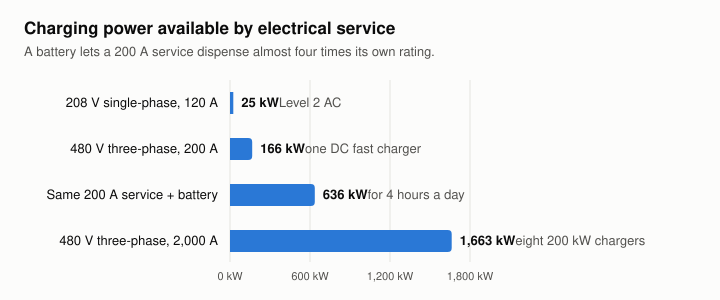
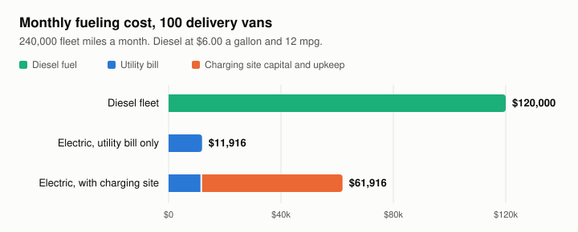

# Fleet depot electrification: what a 100-van charging site asks of the grid

**Kanchi Dave** · MSc Sustainability Management, Columbia University · October 2026

A fleet operator sees an electric depot as a fuel bill. A distribution utility sees the same depot as a new load, a service request, and a capital decision. This case study works through one depot from both sides of the meter, using public data and a small, reproducible model.

It grew out of coursework for *The Sustainable Transportation Economy* at Columbia (Fall 2026). I have rebuilt the analysis here around the question a distribution planner would ask: **how much capacity does fleet charging really need, and what can change that number?**

## Summary

| Finding | Number |
|---|---|
| Peak demand of a 100-van Level 2 depot, unmanaged | 770 kW |
| Demand needed to deliver the same energy spread evenly across available hours | about 400 kW |
| Monthly utility bill on an EV fleet rate, charging kept out of the 4pm to 9pm peak | $11,916 |
| Monthly diesel cost for the same miles | $120,000 |
| Monthly electric cost once the charging site is included | $61,916 (48% below diesel) |
| Share of the all-in electric cost that is infrastructure, not electricity | 81% |
| Power a 200 A service can dispense when paired with a battery | 636 kW for 4 hours, against 166 kW without |
| Capacity value at the PJM backstop price cap | about $203 per kW-year |

Three things follow from these numbers.

1. **Energy is cheap; capacity is the cost.** Four fifths of the depot's all-in fueling cost is the charging site. For the fleet, and for the utility serving it, the decision that matters is how many kW get built.
2. **The peak is a choice.** The vans need about half of what the chargers can deliver in a day. Managed charging can cut the site's peak by almost half without a single van leaving short.
3. **Storage and flexible load can stand in for wires.** A battery behind a small service, or a charging schedule that follows the grid, delivers the same miles with less new capacity.

## 1. What an electrical service can power

The starting point for any site is the service it already has. Power is volts times amps, times √3 for three-phase.

| Service | Capacity | What it supports |
|---|---|---|
| 208 V single-phase, 120 A | 25 kW | A few Level 2 AC chargers |
| 480 V three-phase, 200 A | 166 kW | One DC fast charger |
| 480 V three-phase, 2,000 A | 1,663 kW | Eight 200 kW DC fast chargers |

The jump from the second row to the third is a tenfold service upgrade. That is the request that lands on a distribution engineer's desk.

### Storage as an alternative to the upgrade

Suppose the site keeps its 200 A service and adds a battery that charges from the grid for 20 hours and discharges into trucks for 4.

- Grid energy absorbed over 20 hours: 166 kW × 20 h = **3,326 kWh**
- Dispensing rate over 4 hours, at 85% efficiency and keeping 10% in reserve: **636 kW**
- Energy delivered to six Tesla Semis: 424 kWh each, or about **274 miles** per truck per day at the 1.55 kWh per mile ArcBest recorded in its pilot



The battery lets the site dispense almost four times its service rating while the grid sees a flat 166 kW all day. It does not replace the 2,000 A service, but it covers a six-truck operation without one.

## 2. The depot: 100 delivery vans on Level 2 charging

The example is Amazon's Seattle delivery station as reported by E&E News: 70 Level 2 stations at 10.5 kW serving 100 Rivian vans. I added the course assumptions of 80 miles per van per day, 0.9 kWh per mile, and 0.5 kW of line loss per station between the meter and the charger.

| | |
|---|---|
| Energy into the vans | 216,000 kWh per month |
| Energy purchased, including line losses | 226,286 kWh per month |
| Peak demand, all stations running | 770 kW |
| Load factor | 41% |

### The bill

I priced this on Puget Sound Energy's Schedule 558 for EV fleet charging, using the energy and demand option, with the chargers locked out between 4pm and 9pm.

| Component | Rate | Monthly cost |
|---|---|---|
| Basic charge | $4,413.33 per month | $4,413 |
| Off-peak demand | $1.53 per kW | $1,178 |
| Off-peak energy | $0.02795 per kWh | $6,325 |
| **Total** | | **$11,916** |

That works out to about 5 cents per kWh and 5 cents per mile. A diesel fleet covering the same 240,000 miles at 12 mpg and $6.00 a gallon spends $120,000.

### The charging site changes the picture

A $5 million charging site, carried at $50,000 a month for capital and upkeep, takes the electric cost to $61,916. Electric still wins by 48%, but the cost structure has flipped: the site is now 81% of the total and electricity is 19%.



### How much of the 770 kW is needed

Each van needs 72 kWh a day, which is under seven hours on a 10.5 kW charger. Across the 19 hours the chargers are allowed to run, the 70 stations could deliver almost twice what the fleet uses: utilization is 52%.

Spread evenly over those 19 hours, the same energy needs about **400 kW**. The remaining 370 kW of peak exists only because every van plugs in and starts charging at once. On this rate the fleet has little reason to care, because off-peak demand costs $1.53 per kW. The utility, which has to size the transformer and the feeder for the peak, has every reason to.

## 3. Why the hour matters

**Scale.** One million vehicles charging at 10 kW is 10,000 MW. On the CAISO supply curve for September 16, 2026, no single resource was supplying that much at 8pm; the largest, batteries, was at roughly 8,000 MW. Unmanaged evening charging at that scale would be the largest thing on the system.

**Capacity has a price.** PJM's reliability backstop auction has a price cap of $555 per MW-day, about $203 per kW-year. At that price:

| Resource | Capacity | Capacity value per year |
|---|---|---|
| Voltus and Google residential battery agreement | 100 MW | $20.3 million |
| One home battery (39.2 kWh, 7 hours, about $15,700 installed) | 5.6 kW | $1,134 |
| One Cadillac Lyriq with 10 kW bidirectional charging | 10 kW | $2,026 |

Capacity revenue alone pays back a home battery in about 14 years, so that business model needs other value streams on top. A vehicle has more power to offer than the home battery but is a less dependable resource: it is only available when it is parked and plugged in, and its owner needs the charge for driving.

The cheaper option is to move the charging and leave the battery alone. Shifting the 100-van depot off the evening peak costs nothing in hardware and is already built into the rate above.

## 4. The carbon case depends on the grid

Using EIA 2024 state data (electric power CO2 divided by net generation), over 15,000 miles a year:

| Case | Grid intensity | Electric | Combustion | Reduction |
|---|---|---|---|---|
| Passenger car in Hawaii, 4 mi/kWh against 25 mpg gasoline | 1.30 lb CO2/kWh | 4,872 lb | 12,000 lb | 59% |
| Delivery van in Washington, 2 mi/kWh against 11 mpg diesel | 0.22 lb CO2/kWh | 1,667 lb | 30,000 lb | 94% |

Even on Hawaii's oil-heavy grid, an EV repays an extra 4 metric tons of manufacturing emissions in about 18,600 miles, a little over a year of driving.

## 5. Clean fuel credits

Low carbon fuel standards pay charging station owners for displaced gasoline. Using CARB's formula with the 2026 gasoline benchmark (75.16 gCO2e/MJ), a light-duty EV energy economy ratio of 3.4 and zero-carbon electricity, each kWh dispensed displaces 0.00092 metric tons of CO2.

- California, at the August 2026 average of $77 per credit: **7.1 cents per kWh**, more than the Seattle depot pays per kWh for its electricity
- Washington, at the Q2 2026 price of $45.47: **$9,035 a month** for the 100-van depot, bringing all-in electric cost to $52,881, or 56% below diesel

## 6. Where the market is heading

California's HVIP voucher data for 2026 shows where medium and heavy-duty electrification is landing first. Tesla's Semi took 47% of voucher dollars ($140.6 million of $300.3 million). The remainder went mostly to vehicles with short, predictable, return-to-base duty cycles: school buses (about 47% of non-Tesla dollars), delivery vans (22%), box trucks (12%) and transit buses (11%). Public agencies account for about 58% of non-Tesla dollars, and nearly all of it is battery-electric.

For a distribution utility, return-to-base fleets are the most plannable kind of new load. The vehicles come back to a known address every night, sit for long enough to be charged slowly, and are owned by organizations that can agree to a schedule.

## What I would take into a distribution planning conversation

- **Ask for the duty cycle before sizing the service.** Miles per day and dwell time fix the energy; the nameplate of the chargers only fixes the worst case. In this example the two differ by a factor of two.
- **Price signals shape the peak the utility has to build for.** The 4pm to 9pm lockout moved this load at no capital cost. The low off-peak demand charge then left 370 kW of avoidable peak in place.
- **Compare wires with alternatives on the same basis.** A service upgrade, a site battery and managed charging all deliver the same miles. They differ in capital, in who pays, and in how firm the result is.
- **Fleet economics leave room for cost-sharing.** With a 48% saving against diesel after the site is paid for, fleets have headroom to invest in managed charging or storage when it avoids or defers an upgrade.

## Limits

This is a screening model, not an interconnection study.

- Rates are Puget Sound Energy's, and the fuel and capital figures are course assumptions. I have not rerun the depot on a New York tariff or on a specific network's available capacity, which is the obvious next step.
- State-average grid intensity ignores imports, exports and time of day.
- The battery example uses a single round-trip efficiency and no degradation.
- The 400 kW managed-charging figure assumes vans are available to charge throughout the 19 hours. Real dwell times would raise it.
- Capacity values use the auction price cap, so they are an upper bound.

## Reproduce it

```bash
python3 model.py
```

The script holds every input in one block, prints each result quoted above, and redraws both charts. It uses only the Python standard library.

## Sources

- ArcBest Tesla Semi pilot results (energy use per mile)
- E&E News, "Inside Amazon's EV charging challenge"
- Puget Sound Energy, Electric Schedule 558, General Service for Electric Vehicle Fleet Charging
- U.S. Energy Information Administration, State Electricity Profiles and state CO2 emissions data, 2024
- California HVIP voucher data, 2026
- PJM reliability backstop auction parameters; Voltus and Google capacity agreement
- CAISO, Today's Outlook supply trend, September 16, 2026
- California Air Resources Board, Low Carbon Fuel Standard regulation and monthly credit transfer reports
- Washington Department of Ecology, Clean Fuel Standard credit pricing report, July 2026
